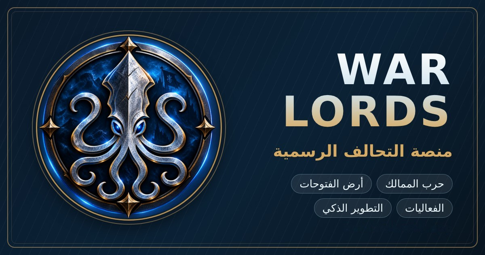

  

<h1 align="center">WAR LORDS — Android App</h1>

  The official Android app of the <b>WAR LORDS</b> alliance, for alliance members.

  <a href="https://github.com/hamsypg/WAR-LORDS-APP/releases/latest/download/war-lords.apk"><b>⬇️ Download the latest APK</b></a>
  &nbsp;·&nbsp;
  <a href="https://github.com/hamsypg/WAR-LORDS-APP/releases">All releases</a>

  <a href="#العربية">العربية</a> · <a href="#english">English</a> · <a href="#türkçe">Türkçe</a>

---

## العربية

**تطبيق أندرويد الرسمي لتحالف WAR LORDS**، وهو مخصّص لأعضاء التحالف. يعمل بالحساب نفسه والبيانات نفسها الموجودة في منصة التحالف: أرض الفتوحات، وحرب الممالك، ومركز الفعاليات، ومركز التطوير.

### التثبيت
1. حمّل الملف [`war-lords.apk`](https://github.com/hamsypg/WAR-LORDS-APP/releases/latest/download/war-lords.apk).
2. افتح الملف، وإذا طلب أندرويد السماح بالتثبيت من هذا المصدر فوافق.
3. سجّل الدخول بالرمز السري وكلمة السر اللذين يعطيك إياهما المشرفون.

### التحديثات التلقائية
- **المحتوى:** يظهر كل تحديث للمنصة في التطبيق مباشرة، دون الحاجة إلى إعادة التثبيت.
- **التطبيق نفسه:** عند صدور نسخة جديدة يُعلمك التطبيق بها، ثم يحمّلها ويثبّتها تلقائيا.

### المتطلبات
أندرويد 7.0 أو أحدث، واتصال بالإنترنت.

---

## English

**The official WAR LORDS alliance app for Android**, for alliance members. It uses the same account and the same data as the alliance platform: Conquest Land, Kingdoms War, the Events Hub and the Growth Hub.

### Install
1. Download [`war-lords.apk`](https://github.com/hamsypg/WAR-LORDS-APP/releases/latest/download/war-lords.apk).
2. Open the file. If Android asks to allow installs from this source, allow it.
3. Log in with the secret code and password the moderators gave you.

### Automatic updates
- **Content:** every platform update shows up in the app right away, with nothing to reinstall.
- **The app itself:** when a new version comes out, the app tells you, then downloads and installs it.

### Requirements
Android 7.0 or newer, and an internet connection.

---

## Türkçe

**WAR LORDS ittifakının resmi Android uygulaması**, ittifak üyeleri içindir. İttifak platformuyla aynı hesabı ve aynı verileri kullanır: Fetihler Diyarı, Krallıklar Savaşı, Etkinlik Merkezi ve Gelişim Merkezi.

### Kurulum
1. [`war-lords.apk`](https://github.com/hamsypg/WAR-LORDS-APP/releases/latest/download/war-lords.apk) dosyasını indir.
2. Dosyayı aç. Android bu kaynaktan yüklemeye izin vermeni isterse izin ver.
3. Moderatörlerin verdiği gizli kod ve şifreyle giriş yap.

### Otomatik güncellemeler
- **İçerik:** Platformdaki her güncelleme uygulamada hemen görünür, yeniden yükleme gerekmez.
- **Uygulamanın kendisi:** Yeni bir sürüm çıktığında uygulama seni bilgilendirir, sonra indirip kendisi yükler.

### Gereksinimler
Android 7.0 veya üstü ve internet bağlantısı.

---

© HAMSypg LLC · WAR LORDS alliance. All rights reserved.

