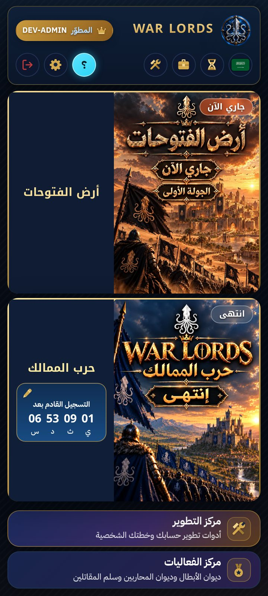
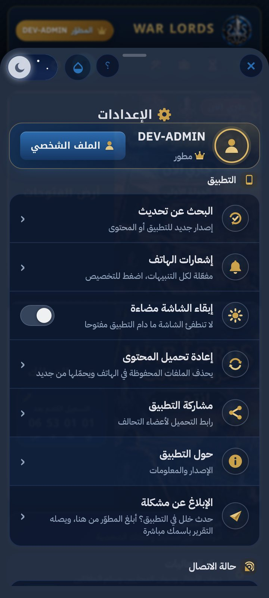
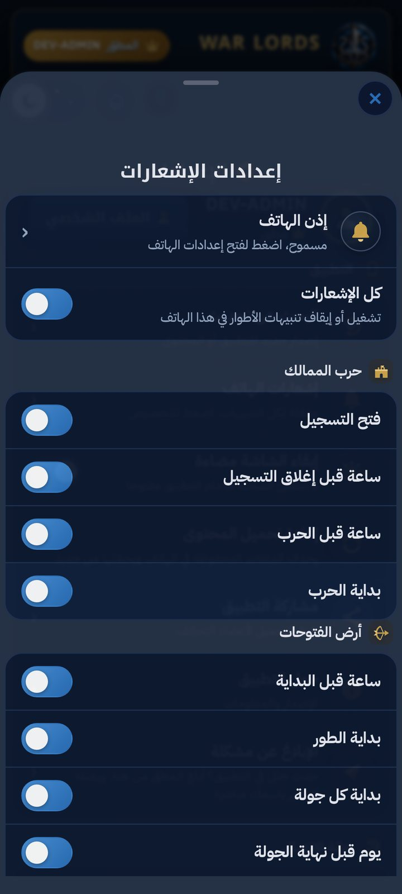
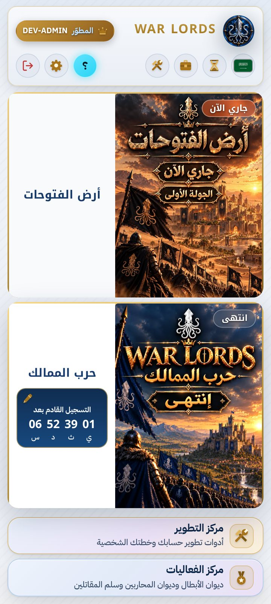
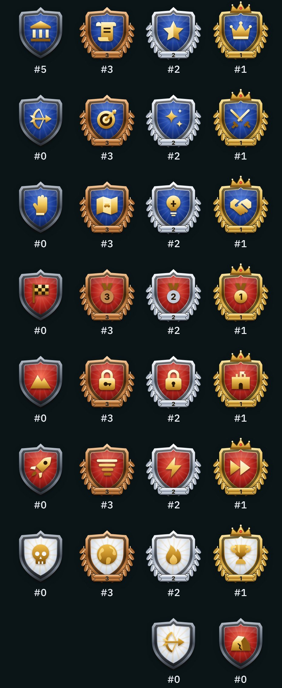
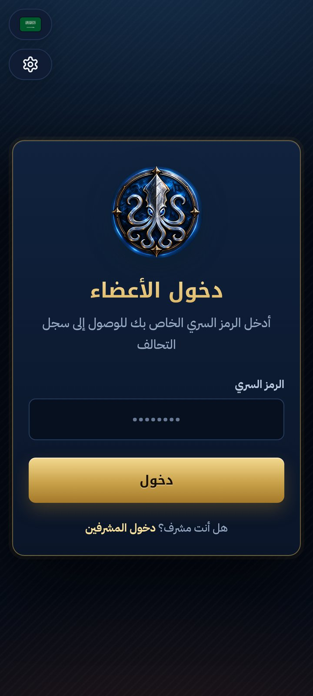
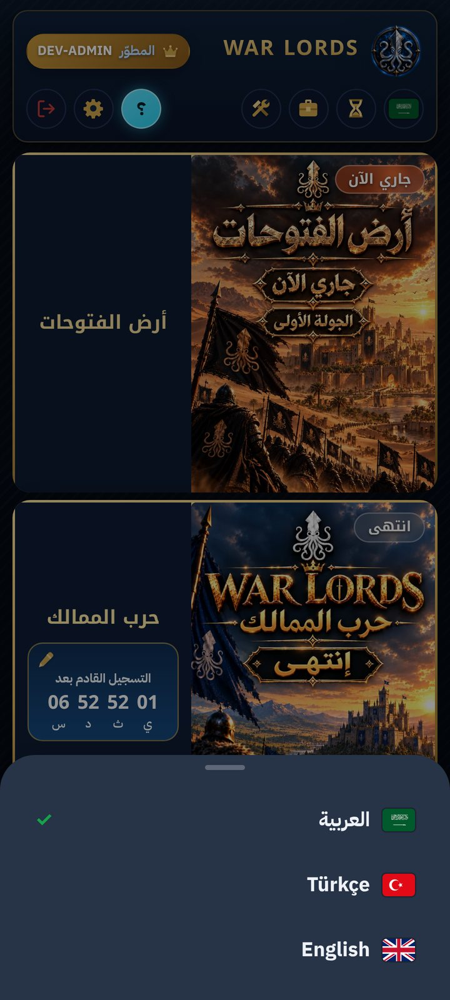
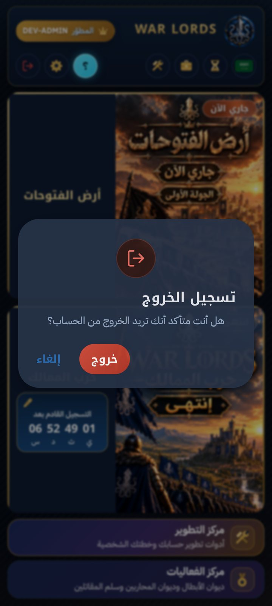

  

<h1 align="center">WAR LORDS | Android App</h1>

  The official Android app of the <b>WAR LORDS</b> alliance, for alliance members.

  <a href="https://github.com/hamsypg/WAR-LORDS/releases/latest"><b>⬇️ Download the latest version</b></a>
  &nbsp;·&nbsp;
  <a href="https://github.com/hamsypg/WAR-LORDS/releases">All releases</a>

  
  
  
  

  <a href="#العربية">العربية</a> · <a href="#english">English</a> · <a href="#türkçe">Türkçe</a>

---

## العربية

**تطبيق أندرويد الرسمي لتحالف WAR LORDS**، وهو مخصّص لأعضاء التحالف. يعمل بالحساب نفسه والبيانات نفسها الموجودة في منصة التحالف: أرض الفتوحات، وحرب الممالك، ومركز الفعاليات، ومركز التطوير.

### المزايا
- **المنصة كاملة في تطبيق:** على كامل الشاشة، بالحساب والبيانات نفسها.
- **فتح سريع:** الصفحات محفوظة في الهاتف، والإنترنت للبيانات فقط. تحديثات المحتوى تُحمَّل في الخلفية، وما تغيّر فقط.
- **إشعارات الأطوار (خاصة بالتطبيق):** لحرب الممالك (فتح التسجيل، وقرب إغلاقه، وقبل الحرب، وبدايتها) ولأرض الفتوحات (البداية، وكل جولة، وقرب نهايتها)، حتى والتطبيق مغلق.
- **إعدادات الإشعارات:** فعّل أو أوقف كل تنبيه على حدة، وشاهد التنبيه القادم، وأرسل إشعارا تجريبيا.
- **تصميم WAR LORDS:** أيقونات ذهبية خاصة، وشارات ألقاب على شكل دروع بإطار ذهبي أو فضي أو برونزي حسب المرتبة، ومظهر فاتح وداكن مع الشفافية.
- **تصميم أندرويد:** نوافذ من أسفل الشاشة، ونوافذ تأكيد أصلية، وثلاث لغات: العربية والإنجليزية والتركية.
- **قسم «التطبيق» في الإعدادات:** البحث عن تحديث، وإعدادات الإشعارات، وإبقاء الشاشة مضاءة، وإعادة تحميل المحتوى، ومشاركة رابط التحميل المباشر، والإبلاغ عن مشكلة.
- **مجاني وبلا إعلانات.**

  

  
  
  

### التثبيت
1. افتح [آخر إصدار](https://github.com/hamsypg/WAR-LORDS/releases/latest) وحمّل ملف `war-lords_v….apk` من قسم Assets.
2. افتح الملف، وإذا طلب أندرويد السماح بالتثبيت من هذا المصدر فوافق.
3. سجّل الدخول بالرمز السري الذي يعطيك إياه المشرفون.

### التحديثات
- **المحتوى:** يصل كل تحديث للمنصة إلى التطبيق تلقائيا، دون إعادة التثبيت.
- **التطبيق نفسه:** عند صدور إصدار جديد يُعلمك التطبيق، ويُحمَّل ملفه في المتصفح مباشرة (لا في تطبيق GitHub) لتثبيته من إشعار التنزيل.

### المتطلبات
أندرويد 7.0 أو أحدث، واتصال بالإنترنت.

---

## English

**The official WAR LORDS alliance app for Android**, for alliance members. It uses the same account and the same data as the alliance platform: Land of Conquests, Kingdoms War, the Events Hub and the Growth Hub.

### Features
- **The whole platform in an app:** full screen, with the same account and data.
- **Fast opening:** pages are stored on the phone and the internet is used for data only. Content updates download in the background, only what changed.
- **Phase notifications (app only):** for the Kingdoms War (registration opens, closing soon, before the war and when it starts) and the Land of Conquests (start, every round and its last hours), even when the app is closed.
- **Notification settings:** turn each alert on or off, see the next alert and send a test notification.
- **WAR LORDS design:** custom gold icons, title badges shaped as shields with a gold, silver or bronze frame by rank, and light and dark themes with transparency.
- **Android design:** bottom sheets, native confirm dialogs and three languages: Arabic, English and Turkish.
- **An "App" section in Settings:** check for updates, notification settings, keep screen on, reload content, share the direct download link and report a problem.
- **Free, with no ads.**

### Install
1. Open the [latest release](https://github.com/hamsypg/WAR-LORDS/releases/latest) and download the `war-lords_v….apk` file under Assets.
2. Open the file. If Android asks to allow installs from this source, allow it.
3. Log in with the secret code the moderators gave you.

### Updates
- **Content:** every platform update reaches the app automatically, with nothing to reinstall.
- **The app itself:** when a new version comes out, the app tells you and downloads it straight in the browser (not in the GitHub app); install it from the download notification.

### Requirements
Android 7.0 or newer, and an internet connection.

---

## Türkçe

**WAR LORDS ittifakının resmi Android uygulaması**, ittifak üyeleri içindir. İttifak platformuyla aynı hesabı ve aynı verileri kullanır: Fetih Toprakları, Krallıklar Savaşı, Etkinlik Merkezi ve Gelişim Merkezi.

### Özellikler
- **Platformun tamamı bir uygulamada:** tam ekran, aynı hesap ve aynı verilerle.
- **Hızlı açılış:** sayfalar telefonda saklanır, internet yalnızca veriler için kullanılır. İçerik güncellemeleri arka planda, yalnızca değişenler olarak iner.
- **Aşama bildirimleri (yalnızca uygulamada):** Krallıklar Savaşı (kayıt açılışı, kapanışa az kala, savaştan önce ve başlangıç) ve Fetih Toprakları (başlangıç, her tur ve son saatleri) için; uygulama kapalıyken bile.
- **Bildirim ayarları:** her uyarıyı ayrı ayrı aç veya kapat, sıradaki uyarıyı gör ve deneme bildirimi gönder.
- **WAR LORDS tasarımı:** özel altın simgeler, sıraya göre altın, gümüş veya bronz çerçeveli kalkan biçiminde unvan rozetleri ve şeffaflıkla açık ve koyu tema.
- **Android tasarımı:** alt paneller, yerel onay pencereleri ve üç dil: Arapça, İngilizce ve Türkçe.
- **Ayarlarda "Uygulama" bölümü:** güncelleme denetimi, bildirim ayarları, ekranı açık tut, içeriği yeniden yükle, doğrudan indirme bağlantısını paylaş ve sorun bildir.
- **Ücretsiz ve reklamsız.**

### Kurulum
1. [En son sürümü](https://github.com/hamsypg/WAR-LORDS/releases/latest) aç ve Assets altındaki `war-lords_v….apk` dosyasını indir.
2. Dosyayı aç. Android bu kaynaktan yüklemeye izin vermeni isterse izin ver.
3. Moderatörlerin verdiği gizli kodla giriş yap.

### Güncellemeler
- **İçerik:** Platformdaki her güncelleme, yeniden yükleme gerekmeden uygulamaya kendiliğinden ulaşır.
- **Uygulamanın kendisi:** Yeni bir sürüm çıktığında uygulama seni bilgilendirir ve dosyasını doğrudan tarayıcıda indirir (GitHub uygulamasında değil); indirme bildiriminden yükle.

### Gereksinimler
Android 7.0 veya üstü ve internet bağlantısı.

---

© HAMSypg LLC · WAR LORDS alliance. All rights reserved.

